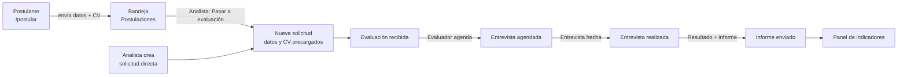
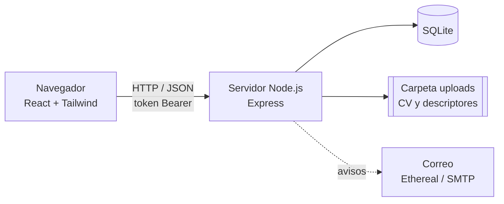
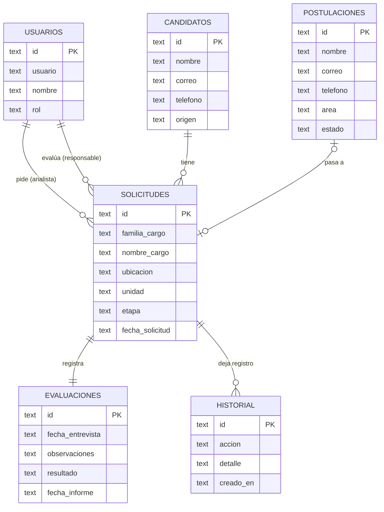

# Sistema de Evaluaciones Psicolaborales · AquaChile

MVP académico desarrollado para la asignatura **Full Stack II (DuocUC)** a partir del caso entregado por el equipo de **Reclutamiento y Selección de AquaChile**.

> ⚠️ **Prototipo académico.** No es una herramienta oficial de AquaChile ni un sistema productivo. **Todos los datos son ficticios** (personas, correos, teléfonos y CV de ejemplo). No contiene información interna de la empresa.

---

## Índice

1. [El problema](#1-el-problema)
2. [La solución](#2-la-solución)
3. [Flujo del proceso](#3-flujo-del-proceso)
4. [Roles y permisos](#4-roles-y-permisos)
5. [Pantallas](#5-pantallas)
6. [Requerimientos del caso cubiertos](#6-requerimientos-del-caso-cubiertos)
7. [Arquitectura y tecnologías](#7-arquitectura-y-tecnologías)
8. [Base de datos](#8-base-de-datos)
9. [API (endpoints)](#9-api-endpoints)
10. [Seguridad y privacidad](#10-seguridad-y-privacidad)
11. [Pruebas](#11-pruebas)
12. [Instalación y ejecución](#12-instalación-y-ejecución)
13. [Datos de demostración y usuarios](#13-datos-de-demostración-y-usuarios)
14. [Estructura de carpetas](#14-estructura-de-carpetas)
15. [Problemas frecuentes](#15-problemas-frecuentes)
16. [Fuera del alcance del MVP](#16-fuera-del-alcance-del-mvp)
17. [Equipo](#17-equipo)

---

## 1. El problema

Hoy la evaluación psicolaboral se coordina con **varias herramientas separadas**:

| Paso                                                           | Herramienta actual  |
| -------------------------------------------------------------- | ------------------- |
| El analista pide la evaluación                                 | Microsoft **Forms** |
| La psicóloga registra los datos                                | **Excel**           |
| Se sigue el avance (recibida → agendada → realizada → informe) | **Planner**         |
| Se avisa que el informe está listo                             | **Correo**          |
| Se revisan indicadores (por mes, por familia, _timing_)        | **Power BI**        |

Esto genera trabajo administrativo repetido, información dispersa y poca visibilidad del estado de cada evaluación.

## 2. La solución

Una **aplicación web** que reúne todo el proceso en un solo lugar:

- **Formulario público** (`/postular`) donde la persona postula con sus datos y su CV.
- **Panel interno con login** (solo para el equipo de Reclutamiento) para revisar postulaciones, crear solicitudes de evaluación, seguir sus etapas, registrar la evaluación y ver indicadores.
- **Avisos por correo** automáticos al evaluador (nueva solicitud) y al analista (informe enviado).

## 3. Flujo del proceso



- **Postulante externo:** viene de fuera de la empresa y postula por el formulario público.
- **Postulante interno:** ya trabaja en AquaChile (por ejemplo, un ascenso). El analista le envía el enlace del formulario (botón _Copiar enlace del formulario_) o crea la solicitud directamente.
- El analista marca el **origen (Interno / Externo)** al crear la solicitud, tal como hoy lo hace en el Forms.

**Etapas y estados.** El caso sugiere 3 estados (_Pendiente, En proceso, Finalizada_). El sistema usa las **4 etapas reales** del Planner y las agrupa en esos 3 estados:

| Etapa (real)                               | Estado (caso) |
| ------------------------------------------ | ------------- |
| Evaluación recibida                        | Pendiente     |
| Entrevista agendada · Entrevista realizada | En proceso    |
| Informe enviado                            | Finalizada    |

## 4. Roles y permisos

| Acción                                   | Admin | Analista | Evaluador | Jefatura |
| ---------------------------------------- | :---: | :------: | :-------: | :------: |
| Ver solicitudes, candidatos y panel      |  ✅   |    ✅    |    ✅     |    ✅    |
| Ver postulaciones web                    |  ✅   |    ✅    |     —     |    ✅    |
| Revisar / descartar postulaciones        |  ✅   |    ✅    |     —     |    —     |
| Registrar candidatos y crear solicitudes |  ✅   |    ✅    |     —     |    —     |
| Editar datos de candidato o solicitud    |  ✅   |    ✅    |    ✅     |    —     |
| Avanzar etapa y registrar evaluación     |  ✅   |    —     |    ✅     |    —     |
| Eliminar solicitudes                     |  ✅   |    ✅    |     —     |    —     |
| Eliminar candidatos y postulaciones      |  ✅   |    —     |     —     |    —     |

- La **jefatura** solo consulta (modo lectura), como pide el caso.
- Los permisos se revisan **en el servidor** en cada petición. El frontend solo oculta lo que el rol no puede usar.
- Si un evaluador avanza una solicitud **sin responsable**, queda asignada a él automáticamente.

## 5. Pantallas

| Página                                                   | Ruta                 | Acceso     |
| -------------------------------------------------------- | -------------------- | ---------- |
| Formulario de postulación                                | `/postular`          | Público    |
| Inicio de sesión                                         | `/login`             | Público    |
| Postulaciones web                                        | `/postulaciones`     | Con sesión |
| Solicitudes (lista con filtros y exportación a Excel)    | `/solicitudes`       | Con sesión |
| Nueva solicitud                                          | `/solicitudes/nueva` | Con sesión |
| Detalle de solicitud (etapas, evaluación, historial, CV) | `/solicitudes/:id`   | Con sesión |
| Candidatos                                               | `/candidatos`        | Con sesión |
| Registrar candidato                                      | `/candidatos/nuevo`  | Con sesión |
| Ficha del candidato                                      | `/candidatos/:id`    | Con sesión |
| Panel de indicadores                                     | `/dashboard`         | Con sesión |

Todas las pantallas son **responsive** (computador y celular) y el panel tiene **modo claro y oscuro**.

## 6. Requerimientos del caso cubiertos

| Código | Requerimiento (texto del caso)                                              | Prioridad | Dónde se cumple                                                      |
| ------ | --------------------------------------------------------------------------- | :-------: | -------------------------------------------------------------------- |
| RF01   | Permitir ingreso simple al sistema con usuarios ficticios o roles simulados |   Alta    | _Login_ con 4 roles (admin, analista, evaluador, jefatura)           |
| RF02   | Registrar candidatos con datos mínimos obligatorios                         |   Alta    | _Registrar candidato_, _Nueva solicitud_ y formulario público        |
| RF03   | Editar y consultar información principal de un candidato                    |   Alta    | _Candidatos_ → ficha → _Editar_                                      |
| RF04   | Crear solicitudes de evaluación asociadas a un candidato                    |   Alta    | _Nueva solicitud_ (candidato nuevo o _Ya registrado_)                |
| RF05   | Registrar cargo, familia de cargo, fecha de solicitud y responsable         |   Alta    | _Nueva solicitud_ (la fecha se registra sola)                        |
| RF06   | Visualizar listado de solicitudes y consultar su detalle                    |   Alta    | _Solicitudes_ y _Detalle de solicitud_                               |
| RF07   | Buscar o filtrar solicitudes por estado, fecha, cargo o candidato           |   Media   | Filtros por etapa, fechas, familia, responsable y texto (sin tildes) |
| RF08   | Actualizar el estado de la solicitud: Pendiente, En proceso o Finalizada    |   Alta    | Avance por etapas en el detalle (4 etapas → 3 estados)               |
| RF09   | Registrar fecha de evaluación, observaciones o resultado general            |   Alta    | Sección _Evaluación_ del detalle                                     |
| RF10   | Mostrar dashboard simple con indicadores generales del proceso              |   Media   | _Panel_                                                              |

**Indicadores del panel:** total de candidatos, pendientes, en proceso y finalizadas (los 4 que pide el caso), más _Requiere atención_, evaluaciones por mes, _timing_ promedio (días desde la solicitud hasta el informe), distribución por familia de cargo y resultados.

**Reglas de negocio destacadas:**

- No se puede pasar a _Entrevista agendada_ sin fecha de entrevista.
- No se puede marcar como realizada una entrevista que todavía no ocurre.
- No se puede enviar el informe sin resultado.
- La entrevista debe quedar dentro del año siguiente a la solicitud.
- El informe no puede tener fecha futura ni anterior a la entrevista.
- Todo cambio queda en el **historial** (quién, qué y cuándo).

## 7. Arquitectura y tecnologías



| Capa                 | Tecnología                                                                 |
| -------------------- | -------------------------------------------------------------------------- |
| Frontend             | **React** + **Vite**, **React Router**, **Tailwind CSS v4**, React Icons   |
| Backend (monolítico) | **Node.js** + **Express**, **Multer** (archivos), **Nodemailer** (correos) |
| Base de datos        | **SQLite** (módulo `node:sqlite` incluido en Node 22.5+)                   |
| Pruebas              | **Vitest**                                                                 |

**Organización del backend en capas:**

- `rutas/` recibe la petición y revisa permisos.
- `servicios/` aplica las reglas de negocio.
- `db.js` accede a la base con consultas parametrizadas.
- `validaciones.js` valida los datos de entrada.

## 8. Base de datos

La base se crea sola al iniciar el servidor, en `server/data/aquachile.db`.



| Tabla           | Qué guarda                                                                                                                          |
| --------------- | ----------------------------------------------------------------------------------------------------------------------------------- |
| `usuarios`      | Personas del equipo, con su rol. La contraseña se guarda cifrada (scrypt + sal), nunca tal cual.                                    |
| `candidatos`    | Nombre, correo (único), celular y origen (interno/externo).                                                                         |
| `solicitudes`   | Cargo, familia, ubicación, unidad, centro de costo, referencias, referido, aspectos a indagar, CV, descriptor, etapa y responsable. |
| `evaluaciones`  | Una por solicitud: fecha de entrevista, observaciones, resultado y fecha del informe.                                               |
| `historial`     | Trazabilidad de cada acción sobre una solicitud.                                                                                    |
| `postulaciones` | Lo que llega del formulario público y su estado (_Por revisar, En evaluación, Descartada_).                                         |

Al eliminar un candidato se eliminan **en cascada** sus solicitudes, evaluaciones, historial y archivos.

## 9. API (endpoints)

Base: `http://localhost:3001/api`

**Públicos (sin sesión)**

| Método | Ruta                     | Descripción                         |
| ------ | ------------------------ | ----------------------------------- |
| GET    | `/health`                | Estado del servidor                 |
| GET    | `/publico/opciones`      | Áreas de interés para el formulario |
| POST   | `/publico/postulaciones` | Enviar postulación con CV (PDF)     |
| POST   | `/login`                 | Iniciar sesión                      |

**Con sesión (token `Authorization: Bearer ...`)**

| Método             | Ruta                                    | Descripción                             |
| ------------------ | --------------------------------------- | --------------------------------------- |
| POST               | `/logout`                               | Cerrar sesión                           |
| GET                | `/sesion`                               | Datos del usuario conectado             |
| GET                | `/catalogos`                            | Familias, unidades, etapas, resultados… |
| GET                | `/usuarios?rol=evaluador`               | Lista de evaluadores                    |
| GET                | `/indicadores`                          | Datos del panel                         |
| GET · POST         | `/candidatos`                           | Listar · registrar                      |
| GET · PUT · DELETE | `/candidatos/:id`                       | Ver · editar · eliminar                 |
| GET · POST         | `/solicitudes`                          | Listar (con filtros) · crear (con CV)   |
| GET · PUT · DELETE | `/solicitudes/:id`                      | Ver · editar · eliminar                 |
| PATCH              | `/solicitudes/:id/etapa`                | Avanzar o retroceder etapa              |
| PUT                | `/solicitudes/:id/evaluacion`           | Registrar la evaluación                 |
| GET                | `/solicitudes/:id/cv` · `/descriptor`   | Descargar adjuntos                      |
| GET                | `/postulaciones` · `/postulaciones/:id` | Bandeja de postulaciones                |
| GET                | `/postulaciones/:id/cv`                 | Descargar CV                            |
| PATCH              | `/postulaciones/:id/estado`             | Descartar o reabrir                     |
| DELETE             | `/postulaciones/:id`                    | Eliminar                                |

## 10. Seguridad y privacidad

- **Panel privado:** todo el sistema interno exige iniciar sesión. Lo único público es el formulario, que **solo envía datos** y nunca muestra información del sistema.
- **Contraseñas cifradas** (scrypt + sal) y comparación en tiempo constante. El login no revela si el usuario existe.
- **Sesiones con vencimiento** (8 horas) y permisos por rol revisados en el servidor.
- **Límite de intentos por IP:** login, envíos y postulaciones públicas.
- **Archivos:**
  - Se revisa el **contenido real** del archivo (no solo la extensión): PDF o DOCX, máx. 5 MB.
  - El nombre del archivo lo genera el servidor.
  - Los archivos solo se descargan con sesión.
- **Formulario público:**
  - Tiene un **campo trampa** contra bots.
  - Exige el consentimiento de uso de datos.
  - Pide solo lo necesario (sin RUT).
- **Consultas SQL parametrizadas** contra inyección SQL. Además, los datos se **escapan** en los correos y se envían **cabeceras de seguridad** HTTP.
- **Datos ficticios:** todos los correos de ejemplo terminan en `@ejemplo.cl`.
- **No se suben al repositorio** `server/.env`, `server/data` ni `server/uploads` (ver `.gitignore`).

## 11. Pruebas

Pruebas automáticas con **Vitest**:

| Dónde    | Comando                  | Pruebas | Qué revisan                                                                                                                                                                             |
| -------- | ------------------------ | ------- | --------------------------------------------------------------------------------------------------------------------------------------------------------------------------------------- |
| Backend  | `cd server` → `npm test` | **112** | Validaciones, reglas de negocio, fechas, permisos por rol, seguridad (contraseñas, sesiones, límite de intentos), indicadores, datos de demo, correos y la API pública de punta a punta |
| Frontend | `npm test` (en la raíz)  | **40**  | Validación de formularios, filtros de búsqueda, formato de fechas y teléfonos, exportación a Excel y nombres de pestaña                                                                 |

**Escenarios de prueba manual** (los que pide el caso: registro, búsqueda, actualización de estado, evaluación y dashboard):

1. Enviar una postulación en `/postular` (con errores y sin ellos).
2. Como **analista**: verla en _Postulaciones_, pasarla a evaluación y crear la solicitud.
3. Buscar y filtrar en _Solicitudes_ (por etapa, responsable, familia y texto).
4. Como **evaluador**: registrar la fecha, agendar, marcar como realizada, poner el resultado y enviar el informe.
5. Revisar que el **Panel** se actualiza.
6. Como **jefatura**: comprobar que solo puede consultar.

## 12. Instalación y ejecución

### Requisitos

- **Node.js 22.5 o superior** (recomendado 24). Comprueba tu versión con `node -v`.
- **Git**.

### Pasos (solo la primera vez)

```bash
# 1. Clonar el repositorio
git clone https://github.com/Nan0-lol/AquaChile_Form.git
cd AquaChile_Form

# 2. Instalar el frontend (en la raíz)
npm install

# 3. Instalar el backend
cd server
npm install

# 4. Cargar los datos de demostración
node seed.js --reset
```

### Encender el sistema (cada vez)

Se necesitan **dos terminales**:

```bash
# Terminal 1: backend (dentro de server/)
cd server
node server.js
# → "Servidor escuchando en http://localhost:3001"
```

```bash
# Terminal 2: frontend (en la raíz del proyecto)
npm run dev
# → abre http://localhost:5173
```

| Qué                | Dirección                      |
| ------------------ | ------------------------------ |
| Formulario público | http://localhost:5173/postular |
| Panel interno      | http://localhost:5173/login    |

### Configuración opcional (`server/.env`)

Copia `server/.env.example` como `server/.env` para cambiar el puerto, los límites de intentos o el correo real (SMTP). Sin configurar nada, el sistema funciona y los correos se envían en **modo prueba (Ethereal)**: no llegan a nadie, y la terminal muestra un enlace para verlos.

## 13. Datos de demostración y usuarios

`node seed.js --reset` borra todo y carga datos **ficticios**:

- 12 candidatos con solicitudes en las 4 etapas.
- 4 postulaciones web (3 por revisar y 1 descartada).
- CV de ejemplo en PDF.

| Usuario      | Contraseña     | Rol                       | Nombre (ficticio)         |
| ------------ | -------------- | ------------------------- | ------------------------- |
| `admin`      | `admin123`     | Administrador             | Administrador del sistema |
| `analista`   | `analista123`  | Analista de Reclutamiento | Carla Rojas               |
| `evaluador`  | `evaluador123` | Profesional Evaluador     | Paula Vidal               |
| `evaluador2` | `evaluador123` | Profesional Evaluador     | Rodrigo Saavedra          |
| `jefatura`   | `jefatura123`  | Jefatura (solo lectura)   | Andrés Pino               |

> Son claves de demostración. En producción el servidor **no crea** estos usuarios: exige definir `ADMIN_USUARIO` y `ADMIN_PASSWORD` en `.env`.

## 14. Estructura de carpetas

```
AquaChile_Form/
├── public/                 Imágenes (logo, fondos) e ícono
├── src/                    FRONTEND (React)
│   ├── pages/              Una página por pantalla (Postular, Solicitudes, Dashboard…)
│   ├── components/         Piezas reutilizables (ui.jsx, AdminHeader, ZonaArchivo…)
│   ├── layouts/            Esqueleto público y del panel
│   ├── services/api.js     Comunicación con el backend
│   ├── utils/              Validaciones, filtros y formatos (+ pruebas *.test.js)
│   ├── auth.js             Sesión del usuario en el navegador
│   └── index.css           Colores de la marca y tema claro/oscuro (Tailwind)
└── server/                 BACKEND (Node.js + Express)
    ├── server.js           Arranque del servidor
    ├── app.js              Arma la API (seguridad, archivos, rutas)
    ├── db.js               Base de datos (tablas y consultas)
    ├── validaciones.js     Validación de datos y archivos
    ├── seguridad.js        Contraseñas, sesiones, límites y cabeceras
    ├── correo.js           Avisos por correo
    ├── seed.js             Datos de demostración
    ├── modelos/            Catálogos y permisos por rol
    ├── rutas/              Endpoints
    ├── servicios/          Reglas de negocio
    └── tests/              Pruebas del backend
```

## 15. Problemas frecuentes

| Síntoma                                                     | Solución                                                                                        |
| ----------------------------------------------------------- | ----------------------------------------------------------------------------------------------- |
| `"vite" no se reconoce…`                                    | Falta instalar: `npm install` en la raíz.                                                       |
| `Cannot find package 'express'`                             | Falta instalar el backend: `cd server` → `npm install`.                                         |
| `npm.ps1 … ejecución de scripts deshabilitada` (PowerShell) | Usa `npm.cmd install`, o ejecuta una vez `Set-ExecutionPolicy -Scope CurrentUser RemoteSigned`. |
| La página dice _"No pudimos conectarnos con el servidor"_   | El backend no está encendido: `cd server` → `node server.js`.                                   |
| Hice cambios en `server/` y no se ven                       | Reinicia el servidor (**Ctrl + C** y `node server.js`).                                         |
| La página se ve sin estilos                                 | Revisa que `src/main.jsx` tenga `import './index.css'` y reinicia `npm run dev`.                |
| Quiero volver a los datos iniciales                         | `cd server` → `node seed.js --reset`.                                                           |
| _"Demasiados intentos de inicio de sesión"_                 | Espera 15 minutos o reinicia el servidor.                                                       |

## 16. Fuera del alcance del MVP

Quedan como **evolución futura** (fuera del alcance obligatorio del curso, según el caso):

- **IA** para generar un borrador del informe psicolaboral (planificada para la 3.ª evaluación).
- Integración con **Microsoft 365** (Outlook, Planner, SharePoint, Power BI) y con el sitio real _Trabaja con nosotros_.
- Inicio de sesión corporativo (SSO) y gestión de usuarios desde la interfaz.
- Agenda de entrevistas con calendario y aviso al candidato.
- Base de datos en la nube y respaldo automático.

## 17. Equipo

- **Diego Barria**
- **Fernando Castillo**

Asignatura Full Stack II · DuocUC · 2026
